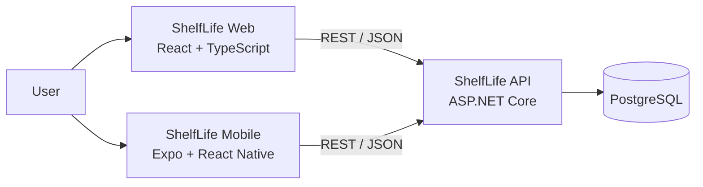

# ShelfLife Web

<div align="center">

**A little less waste, one shelf at a time.**

A grocery inventory web app for keeping track of what you have, knowing what needs using soon and making better use of the food already in your kitchen.


</div>

ShelfLife is built around a simple idea: it is easier to use food before it goes to waste when you have a clear picture of what is already at home.

This repository contains the web application. It communicates with the shared [ShelfLife API](https://github.com/ZinhleHlongwane/ShelfLife-API), so inventory records are stored by the backend rather than only in the browser.

## What I built

The current web experience focuses on the everyday inventory workflow:

- Add food with a name, quantity, measurement unit, expiry date and storage area.
- View inventory loaded from the API.
- Filter items by fridge, pantry or freezer.
- See the total number of items and how many are expiring within the next three days.
- Edit an existing item or remove it from the inventory.
- Get loading, empty and error feedback when working with the API.

The interface is designed to keep the main task straightforward: add what you have, check what needs using and keep the list up to date.

## How the application fits together

The web app is one of two clients using the same backend. The mobile app also reads and updates inventory through the API.



The web client handles presentation and user interaction. The API owns inventory operations and persistence. This keeps the inventory contract in one place instead of maintaining separate web and mobile datasets.

## A few implementation details

### Working with the API

The inventory service handles the HTTP requests for listing, creating, updating and deleting items. The UI does not need to know how the API stores the records.

### Keeping the data contract consistent

The web app has its own frontend types, while the API uses enum names such as `Kilogram` and `Fridge`. The mapping layer converts those values to the shorter labels used in the interface, such as `kg` and `fridge`.

Expiry dates are sent as calendar dates in `YYYY-MM-DD` format. They are not treated as timestamps, which helps avoid shifting a food item's date because of timezone conversion.

### Handling API failures

The inventory screen accounts for loading, saving, deleting and failed requests. If the API cannot be reached, the user gets an error instead of the application silently pretending that a change was saved.

## Technology

| Area | Technology |
|---|---|
| UI | React 19 |
| Language | TypeScript |
| Development and build | Vite 8 |
| API communication | Fetch API, REST and JSON |
| Backend | ASP.NET Core / .NET 10 |
| Persistence | PostgreSQL, Entity Framework Core |
| CI | GitHub Actions |

## Run it locally

### Requirements

- Node.js 22 or later
- npm
- The [ShelfLife API](https://github.com/ZinhleHlongwane/ShelfLife-API) running locally

### 1. Clone and install

```bash
git clone https://github.com/ZinhleHlongwane/ShelfLife-WebApp.git
cd ShelfLife-WebApp
npm install
```

### 2. Start the API

Follow the setup instructions in the ShelfLife API repository. The Vite development server proxies `/api` and `/health` to `http://localhost:5000` by default.

If your API uses a different local address, set `SHELFLIFE_API_PROXY` before starting Vite:

```bash
SHELFLIFE_API_PROXY=http://localhost:5001 npm run dev
```

On Windows PowerShell:

```powershell
$env:SHELFLIFE_API_PROXY="http://localhost:5001"
npm run dev
```

For a direct API origin instead of the development proxy, set `VITE_API_BASE_URL` in a local `.env` file. The example file is `.env.example`.

### 3. Start the web app

```bash
npm run dev
```

Vite prints the local development URL, usually `http://localhost:5173`.

### 4. Run the checks

```bash
npm run lint
npm run build
```

GitHub Actions runs the lint and production-build checks on pushes and pull requests to `main`.

## Project structure

```text
src/
├── components/       # Reusable interface components
├── features/
│   └── inventory/    # API service, DTO mapping and inventory logic
├── models/           # Frontend data types
├── screens/          # Inventory screen
├── services/         # Supporting service integrations
└── utils/            # Date and shared helpers
```

## Current limitations

ShelfLife is still being developed. The current web repository is focused on the inventory experience.

- Authentication and household-specific permissions are not implemented in the API yet.
- The API currently exposes inventory operations without user sign-in. Do not expose the development API publicly or use it for real household data.
- Offline inventory access and sync conflict handling are not implemented.
- Barcode lookup, recipe suggestions, shopping lists and expiry notifications are future work, not current web features.
- Automated browser and end-to-end tests are not yet included.

## What's next

- [x] Connect the web inventory screen to the shared API.
- [x] Add create, read, update and delete inventory operations.
- [x] Add storage filters and expiry summaries.
- [x] Add GitHub Actions lint and build checks.
- [ ] Add automated component and browser tests.
- [ ] Implement authentication and household-level access in the API.
- [ ] Add offline-aware inventory behaviour.
- [ ] Explore barcode lookup, shopping lists and expiry reminders.

---

Built by [Zinhle Hlongwane](https://github.com/ZinhleHlongwane) · Johannesburg, South Africa 🇿🇦
