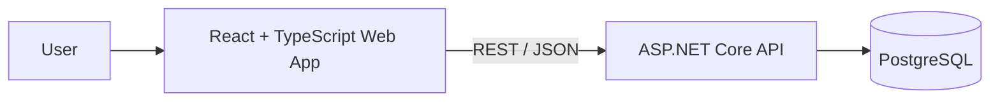

# ShelfLife Web

**A responsive grocery inventory application for tracking food, monitoring expiry dates and reducing household food waste.**

ShelfLife helps people keep track of groceries they already have, see what needs using soon and make better use of food before it goes to waste.

This repository contains the React web client. It connects to the shared [ShelfLife ASP.NET Core API](https://github.com/ZinhleHlongwane/ShelfLife-API), which persists inventory records in PostgreSQL.

## Current features

- Add food items with quantity, measurement unit, expiry date and storage category
- Load inventory from the shared backend
- Filter items by fridge, pantry or freezer
- View expiry status and days remaining
- Edit existing inventory items
- Delete inventory items
- Loading, empty and API error states
- Responsive layout for desktop and mobile browsers

## Architecture



The web client and mobile client are intended to use the same API and household inventory data.

## Technology

| Area | Technology |
|---|---|
| UI | React 19 |
| Language | TypeScript |
| Build tool | Vite |
| API communication | Fetch API / REST |
| Backend | ASP.NET Core / .NET 10 |
| Persistence | PostgreSQL / Entity Framework Core |
| CI | GitHub Actions |

## Run locally

### Prerequisites

- Node.js 22 or later
- npm
- The [ShelfLife API](https://github.com/ZinhleHlongwane/ShelfLife-API) running locally

### Install dependencies

```bash
npm install
```

### Configure the API

By default, Vite proxies `/api` and `/health` requests to `http://localhost:5000`.

Start the API on that address before starting the web client. If the API runs elsewhere, set `SHELFLIFE_API_PROXY` to its local origin when starting Vite, or set `VITE_API_BASE_URL` in a local `.env` file to the API origin.

Example `.env`:

```env
VITE_API_BASE_URL=
```

An empty value uses the Vite development proxy. For a deployed API, set the full HTTPS origin.

### Start the web app

```bash
npm run dev
```

Vite prints the local URL, usually `http://localhost:5173`.

### Quality checks

```bash
npm run lint
npm run build
```

GitHub Actions runs dependency installation, linting and a production build on pushes and pull requests to `main`.

## API contract

The web client uses these endpoints:

| Method | Endpoint | Purpose |
|---|---|---|
| GET | `/api/inventory` | List inventory |
| POST | `/api/inventory` | Add an item |
| GET | `/api/inventory/{id}` | Retrieve an item |
| PUT | `/api/inventory/{id}` | Update an item |
| DELETE | `/api/inventory/{id}` | Remove an item |

The client maps its short measurement labels (`g`, `kg`, `ml`, `l`, `count`) to the API's enum names and converts API date-only values to local calendar dates.

## Project structure

```text
src/
├── components/          # Reusable inventory components
├── features/
│   └── inventory/       # API service, contracts and inventory logic
├── models/              # Frontend domain types
├── screens/             # Application screens
├── services/            # External service integrations
└── utils/               # Date and shared helpers
```

## Current limitations

- Authentication and household-specific access are not implemented yet.
- Barcode lookup, recipe suggestions, shopping lists and notifications remain planned features.
- The API must be running for inventory data to load and persist.
- Production deployment and end-to-end browser testing are still outstanding.

## Roadmap

- [x] Connect inventory listing and CRUD operations to the ASP.NET Core API
- [x] Add GitHub Actions lint and build checks
- [ ] Add automated component and browser tests
- [ ] Connect the mobile application to the shared API
- [ ] Implement authentication and household ownership in the backend
- [ ] Add barcode lookup and food-data integration
- [ ] Add recipe suggestions and shopping lists
- [ ] Add expiry notifications
- [ ] Deploy the web application and API

---

Built by [Zinhle Hlongwane](https://github.com/ZinhleHlongwane) · Johannesburg, South Africa
