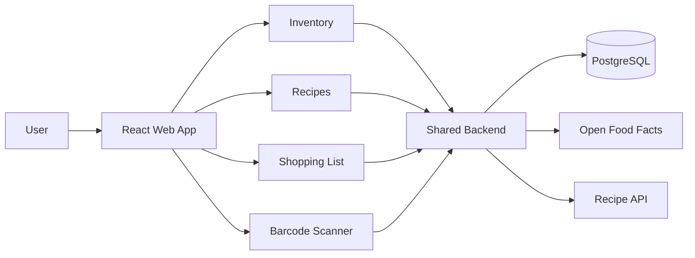

<div align="center">

# 🥬 ShelfLife Web

**A web application for tracking groceries, monitoring expiry dates and reducing household food waste.**


</div>

ShelfLife helps users keep track of food they already have, understand what is close to expiring and make better use of groceries before they go to waste.

The web application is part of a wider ShelfLife idea that I want to evolve into a shared food-management platform across web and mobile.

## The problem

Food often gets wasted because people forget what they already have or notice expiry dates too late.

ShelfLife is built around a simple question:

> What if your food inventory could tell you what needs attention before it becomes waste?

## Current direction

The project is being structured around several core features:

```text
Inventory
Expiry tracking
Notifications
Recipe suggestions
Shopping lists
Barcode scanning
External food data
```

The long-term goal is to connect those features into one household food-management experience.

## Planned architecture



The current repository is primarily the web client. The shared backend is part of the next phase of the project.

## Product vision

I want ShelfLife to eventually support:

- adding groceries manually
- scanning food barcodes
- expiry-date tracking
- highlighting food that should be used soon
- recipe suggestions based on available ingredients
- automatic shopping-list generation
- shared household inventories
- food-waste analytics
- notifications for expiring items

## Why I built it

ShelfLife started as an opportunity to practise React, but the problem itself had enough potential to grow beyond a frontend exercise.

I want to use it to practise how a real product evolves:

```text
UI
→ application state
→ backend
→ database
→ external APIs
→ web + mobile clients
```

That makes it a useful project for learning both software architecture and product thinking.

## Web and mobile

ShelfLife also has a mobile client built with React Native and Expo.

The goal is for both applications to eventually share the same backend and household inventory data.

```text
             ShelfLife Backend
                    │
          ┌─────────┴─────────┐
          ↓                   ↓
     Web Application      Mobile App
```

## Tech stack

| Area | Technology |
|---|---|
| **Frontend** | React |
| **Build tool** | Vite |
| **Language** | JavaScript |
| **Planned backend** | REST API |
| **Planned database** | PostgreSQL |
| **Planned integrations** | Open Food Facts, recipe API |

## Current status

ShelfLife Web is still under active development.

Some parts of the intended feature structure exist in the repository before the full behaviour has been implemented.

I prefer keeping that visible rather than presenting unfinished features as complete.

## What's next

- [ ] Remove committed `node_modules`
- [ ] Complete the inventory feature
- [ ] Add persistent storage through a backend
- [ ] Connect the web and mobile applications
- [ ] Add expiry-date notifications
- [ ] Add Open Food Facts barcode lookup
- [ ] Add recipe recommendations
- [ ] Add shared household accounts
- [ ] Add automated tests
- [ ] Deploy the web application
- [ ] Add screenshots and a short product demo

---

<p align="center">Built by <a href="https://github.com/ZinhleHlongwane">Zinhle Hlongwane</a> · Johannesburg 🇿🇦 · <a href="https://www.linkedin.com/in/zinhle-hlongwane-872354209">LinkedIn</a></p>
